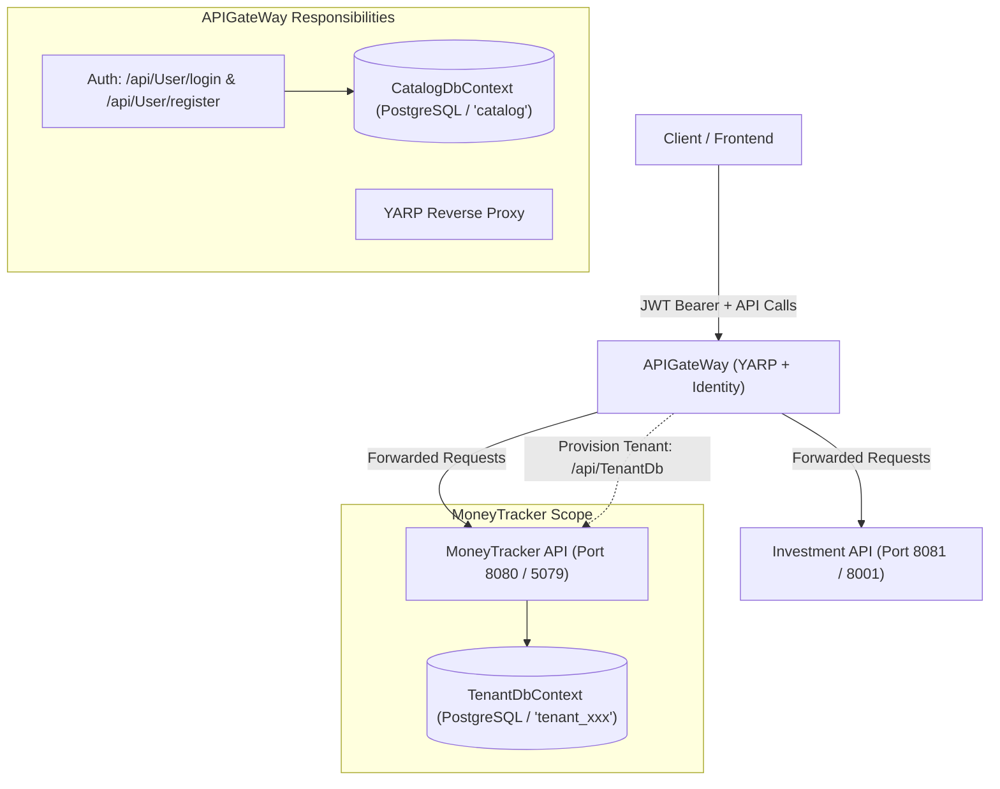

# Authentication Migration Review & Action Plan

**Date:** 2026-10-11  
**Branch:** `sandbox/feat/gateway-authentication`  
**Status:** Completed (Gateway Auth Offloading Implemented)  

---

## 1. Executive Summary

This document captures the current state, identified gaps, security risks, and pending tasks for migrating Authentication and Tenant Catalog management from the downstream service (**MoneyTracker**) to the Reverse Proxy API Gateway (**APIGateWay**).

---

## 2. Current Implementation State

### Completed Components
1. **APIGateWay**:
   - Integrated ASP.NET Core Identity with PostgreSQL under `catalog` schema ([`APIGateWay/Data/CatalogDbContext.cs`](file:///D:/Projects/MoneyTracker/APIGateWay/Data/CatalogDbContext.cs)).
   - Implemented user registration and login endpoints ([`APIGateWay/Controllers/UserController.cs`](file:///D:/Projects/MoneyTracker/APIGateWay/Controllers/UserController.cs)).
   - Added JWT token generation service ([`APIGateWay/Services/JWT/JWTTokenService.cs`](file:///D:/Projects/MoneyTracker/APIGateWay/Services/JWT/JWTTokenService.cs)).
   - Added tenant schema provisioning client ([`APIGateWay/Services/Tenant/TenantProvisioningService.cs`](file:///D:/Projects/MoneyTracker/APIGateWay/Services/Tenant/TenantProvisioningService.cs)).
   - Configured YARP reverse proxy for `MoneyTracker` and `Investment` services ([`APIGateWay/appsettings.json`](file:///D:/Projects/MoneyTracker/APIGateWay/appsettings.json)).

2. **MoneyTracker**:
   - Removed ASP.NET Identity, user controllers, user DTOs, and `CatalogDbContext`.
   - Added dynamic schema migration endpoint ([`MoneyTracker/Controllers/TenantDbController.cs`](file:///D:/Projects/MoneyTracker/MoneyTracker/Controllers/TenantDbController.cs)).
   - Implemented [`TenantSchemaContext`](file:///D:/Projects/MoneyTracker/MoneyTracker/Data/TenantSchemaContext.cs) for dynamic per-request search path resolution.

---

## 3. Critical Gaps & Remaining Tasks

### 🚨 1. Multi-Tenancy & Tenant Schema Propagation (Blocker)
- **Problem:**
  - In `MoneyTracker`, [`TenantDbContext`](file:///D:/Projects/MoneyTracker/MoneyTracker/Data/TenantDbContext.cs#L36-L40) sets PostgreSQL `SearchPath` using the `schemaName` HTTP header via [`TenantService.GetCurrentTenantSchemaName()`](file:///D:/Projects/MoneyTracker/MoneyTracker/Services/Tenant/TenantService.cs#L7).
  - When clients authenticate through `APIGateWay`, the issued JWT token only contains `sub`, `email`, `name`, `jti`, and `role` claims, but **no tenant schema information**.
  - `APIGateWay` does not inject the `schemaName` header when forwarding requests via YARP.
  - As a result, proxied requests to `MoneyTracker` fail with `"A tenant schema must be selected before using the database context."`.
  - Allowing clients to send their own `schemaName` header introduces a **Critical Tenant Spoofing Vulnerability**.
- **Action Needed:**
  - **Option A (Recommended):** Add `tenant_id` and `schemaName` as claims directly inside the JWT token in [`JWTTokenService.GenerateToken()`](file:///D:/Projects/MoneyTracker/APIGateWay/Services/JWT/JWTTokenService.cs#L11). Downstream services extract the validated claim from the token.
  - **Option B:** Implement a custom YARP Transform / Middleware in `APIGateWay` that looks up the tenant schema for the authenticated user and injects the `schemaName` downstream header, stripping any client-supplied header.

---

### 🔀 2. YARP Routing & Endpoint Alignment
- **Stale Route (`money_tracker_users`):**
  - In [`APIGateWay/appsettings.json`](file:///D:/Projects/MoneyTracker/APIGateWay/appsettings.json#L96-L101), route `money_tracker_users` routes `api/Users/{**catch-all}` to `money_tracker`.
  - `MoneyTracker` no longer possesses a `UserController`.
  - **Action Needed:** Remove `money_tracker_users` from YARP routes to prevent 404 proxying errors.
- **Route Naming (Singular vs Plural):**
  - Gateway's `UserController` is routed to `api/User` (e.g., `api/User/register`, `api/User/login`). Ensure client integrations and OpenAPI documentation match this path.

---

### 🌐 3. Internal Service-to-Service Communication
- **Hardcoded Localhost URL:**
  - In [`APIGateWay/Services/Tenant/TenantProvisioningService.cs#L16`](file:///D:/Projects/MoneyTracker/APIGateWay/Services/Tenant/TenantProvisioningService.cs#L16), the URL is hardcoded to `http://localhost:5079/api/TenantDb`.
  - In Docker Compose / Kubernetes / Staging, the internal hostname is `http://moneytracker:8080/`.
  - **Action Needed:** Use `IConfiguration` or register a typed `HttpClient` with a configurable base address in [`APIGateWay/Program.cs`](file:///D:/Projects/MoneyTracker/APIGateWay/Program.cs).
- **Protecting `/api/TenantDb`:**
  - [`MoneyTracker/Controllers/TenantDbController.cs`](file:///D:/Projects/MoneyTracker/MoneyTracker/Controllers/TenantDbController.cs) allows creating arbitrary PostgreSQL schemas without authentication or secret verification.
  - **Action Needed:** Secure this endpoint with an internal secret / API key header, or restrict network access exclusively to internal gateway calls.

---

### 🛡️ 4. Auth Architecture Clarification

Choose and align the downstream authentication strategy:

| Strategy | Gateway Role | Downstream (`MoneyTracker`) Role | Pros / Cons |
| :--- | :--- | :--- | :--- |
| **Token Propagation (Zero-Trust)** *(Current)* | Validates JWT; YARP forwards `Authorization: Bearer <token>` | Validates JWT (`AddJwtBearer`); reads claims (`sub`, `role`, `schemaName`) | Higher security (Defense in Depth); requires shared JWT config across services. |
| **Gateway Auth Offloading** | Validates JWT; strips token; injects `X-User-Id`, `X-Tenant-Schema` | Trusts gateway headers; removes `AddJwtBearer` | Simpler downstream services; requires strict internal network isolation. |

---

### 🔒 5. Security & Quality Improvements
- **Exception Sanitization:**
  - In [`APIGateWay/Controllers/UserController.cs#L59-L61`](file:///D:/Projects/MoneyTracker/APIGateWay/Controllers/UserController.cs#L59-L61), `ex.Message` is returned directly to clients on HTTP 500.
  - **Action Needed:** Log errors via `ILogger` and return a generic error message.
- **Identity Result Errors:**
  - Return detailed `result.Errors` when `userManager.CreateAsync` fails so callers receive actionable validation feedback (password complexity, duplicate username, etc.).
- **Docker Compose Networking & Config:**
  - Ensure JWT keys, issuer, audience, and database connection strings are consistently supplied via environment variables in [`docker-compose.yml`](file:///D:/Projects/MoneyTracker/docker-compose.yml).

---

## 4. Prioritized Action Checklist

| Priority | Task | Status | Target File(s) |
| :---: | :--- | :---: | :--- |
| 🔴 **P0** | Add `schemaName` and `tenantId` claims to JWT token during generation | ✅ Done | [`APIGateWay/Services/JWT/JWTTokenService.cs`](file:///D:/Projects/MoneyTracker/APIGateWay/Services/JWT/JWTTokenService.cs) |
| 🔴 **P0** | Update `MoneyTracker`'s `TenantService` to read schema from `X-Tenant-Schema` header / claims | ✅ Done | [`MoneyTracker/Services/Tenant/TenantService.cs`](file:///D:/Projects/MoneyTracker/MoneyTracker/Services/Tenant/TenantService.cs) |
| 🟠 **P1** | Configure YARP transforms to strip JWT & inject trusted headers (`X-User-Id`, `X-Tenant-Schema`) | ✅ Done | [`APIGateWay/Program.cs`](file:///D:/Projects/MoneyTracker/APIGateWay/Program.cs) |
| 🟠 **P1** | Remove obsolete `money_tracker_users` route from YARP config | ✅ Done | [`APIGateWay/appsettings.json`](file:///D:/Projects/MoneyTracker/APIGateWay/appsettings.json) |
| 🟠 **P1** | Make downstream URL in `TenantProvisioningService` configurable | ✅ Done | [`APIGateWay/Services/Tenant/TenantProvisioningService.cs`](file:///D:/Projects/MoneyTracker/APIGateWay/Services/Tenant/TenantProvisioningService.cs) |
| 🟠 **P1** | Add internal API key / secret protection to `TenantDbController` | ✅ Done | [`MoneyTracker/Controllers/TenantDbController.cs`](file:///D:/Projects/MoneyTracker/MoneyTracker/Controllers/TenantDbController.cs) |
| 🟡 **P2** | Sanitize exception messages returned from `UserController` | ✅ Done | [`APIGateWay/Controllers/UserController.cs`](file:///D:/Projects/MoneyTracker/APIGateWay/Controllers/UserController.cs) |
| 🟡 **P2** | Return structured `IdentityResult.Errors` on registration failure | ✅ Done | [`APIGateWay/Controllers/UserController.cs`](file:///D:/Projects/MoneyTracker/APIGateWay/Controllers/UserController.cs) |
| 🟡 **P2** | Configure shared JWT and internal secret settings in `docker-compose.yml` | ✅ Done | [`docker-compose.yml`](file:///D:/Projects/MoneyTracker/docker-compose.yml) |
